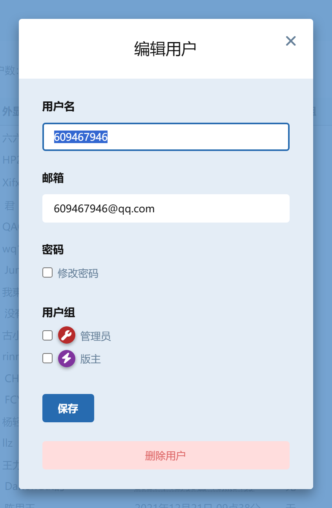

# 删除用户入口（liufencn/flarum-user-delete）

给 Flarum 2.x 后台补回「**删除用户**」按钮。

Flarum 2.0 重写了后台用户管理，「编辑用户」弹窗（`EditUserModal`）里**没有删除按钮**了——但后端能力一直都在：`DELETE /api/users/{id}` 端点、`UserPolicy::can('delete')`、序列化的 `canDelete` 字段全都还在。本扩展只做一件事：在编辑弹窗底部注入一个**两步确认**的删除按钮，把前端入口补回来。

**零依赖、零配置**——纯前端扩展，不碰任何 PHP 类、不改 Flarum 核心与 vendor 文件。



## 为什么需要这个扩展

升级到 Flarum 2.0 后，后台「用户」页点开任何一个用户的编辑弹窗，只有「保存」，找不到删除。想删用户只能：

- 翻到用户个人页一个个点（前台没有删除入口），或
- 直接操作数据库。

而这个功能在 1.x 后台是有的。本扩展把它加回来，并加上防误删的两步确认。

## 功能特性

- **两步确认**：第一次点击按钮进入「确认删除？此操作不可撤销」的 armed 态（红色高亮，5 秒无操作自动收起）；第二次点击才真正发出 `DELETE` 请求。不会手滑删人。
- **请求期 loading**：删除请求发出后按钮进入 loading 禁用态，防止重复提交。
- **成功即刷新**：删除成功后关闭弹窗并重载用户列表页（列表是分页快照，重载最稳，计数不会错）。
- **失败走标准错误展示**：请求失败复用核心 `FormModal.onerror`，错误信息与其它后台操作一致。
- **中英双语**：内置 `zh-Hans` / `en` 语言包。

## 安全闸（三道，缺一不可）

按钮是否出现由三层判断决定，**后端始终有最终把关**：

| 条件 | 行为 | 原因 |
|---|---|---|
| `id === 1`（root admin） | 不显示 | `User` 模型 boot 里对 root 有 `DomainException` 硬拒，显示了也删不掉 |
| 当前登录用户自己 | 不显示 | 防止管理员删掉自己导致后台失控 |
| `canDelete() === false` | 不显示 | 尊重后端序列化结果（如目标用户是其他管理员等场景） |

## 安装

```bash
composer require liufencn/flarum-user-delete
php flarum extension:enable liufencn-user-delete
php flarum cache:clear
```

也可以手动部署：把本仓库放到 `extensions/liufencn-user-delete/`，再在后台启用。扩展 id 为 `liufencn-user-delete`。

启用后打开「后台 → 用户」，点任意用户进入编辑弹窗，底部即可看到红色「删除用户」按钮（对 root、对自己、对无权限目标不出现）。

## 实现说明

- **纯 JS 扩展**：无 PHP 类，不声明 autoload；`extend.php` 只注册语言包和 admin 前端资源，`js/dist/admin.js` 为手写 IIFE（不走 webpack 构建）。
- **override `EditUserModal.fields()`**：在表单项 `ItemList` 末尾（`priority = -20`）追加一个 `Button--danger` 按钮。
- Flarum 2.0 前端扩展 API 要点（源码注释里有完整说明）：dist 末尾必须有 `module.exports = { extend: [] }`（否则污染模块注册表中断整站 JS）、`override()` 字符串路径必须带 `flarum/` 前缀、必须在 `app.initializers.add()` 内调用、懒加载 chunk 经 `reg.onLoad` 自动打补丁。

## 测试情况

已在生产站点（bbs.cathi.cn，Flarum 2.0.0 GA）无头浏览器端到端验证：按钮渲染 → armed 确认态 → 二次点击 → `DELETE` 200 → 弹窗关闭 → 列表刷新；数据库复核用户已删除；root 与当前用户弹窗不出现按钮；站点无新增 JS 错误。

## 致谢

- [Flarum](https://flarum.org) — MIT

## License

**AGPL-3.0-or-later** — 可自由使用、修改、商用；但若你修改后对外提供服务，必须以相同许可开源你的改动。完整条款见 [LICENSE](LICENSE)。

## 联系作者 / Contact

| 渠道 | 地址 |
|---|---|
| 🏝️ 论坛（CatIsland） | https://bbs.cathi.cn |
| 💬 QQ 交流群 | 369748859 |
| 📮 邮箱 | 792818521@qq.com |
